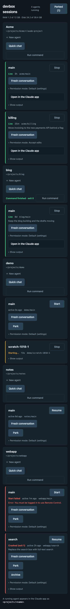
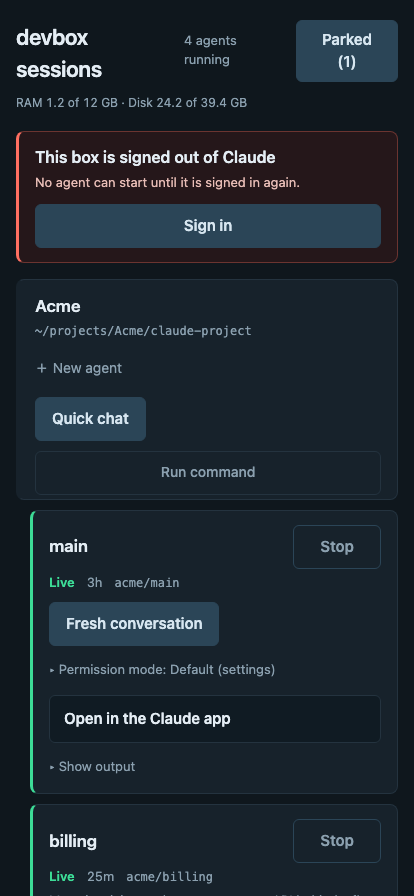
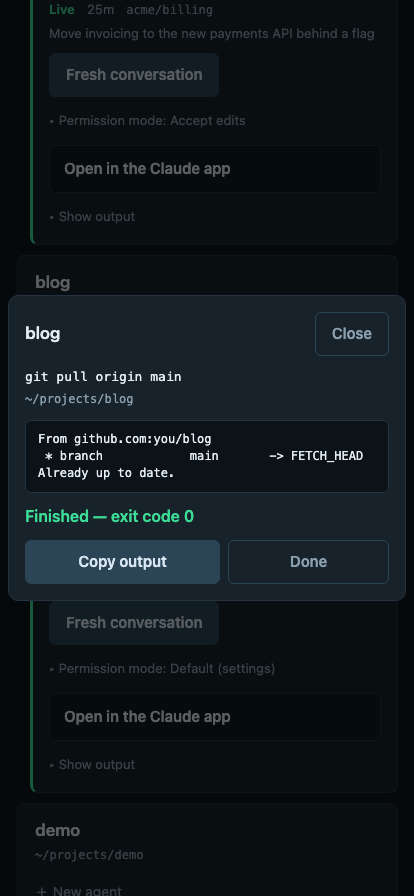

# devbox-launcher

A small web UI and command line for running **named, long-lived
[Claude Code](https://claude.com/claude-code) agents** on a headless
development box — so you can start, resume and retire them from your phone
without SSHing in.

Each agent is an interactive `claude --remote-control` session in tmux. You
drive it in the Claude mobile app or at claude.ai/code, or attach to it from a
terminal; the launcher starts, stops, parks and monitors it.

<p align="center">
  
</p>

Every project row lists its agents. The coloured rail is a health signal, not
just "process alive" — green means the agent is live and reachable from the
app, amber that it is starting or not connected, red that it failed or crashed,
with Claude's own error underneath.

When the box's Claude login expires every agent fails the same way, so the
launcher lets you fix that from the phone too, without a shell:

<p align="center">
  
</p>

Claude sometimes needs *you* to run a command — a production deploy, an
interactive login — and over Remote Control you cannot type `! <cmd>` from the
app. **Run command** runs it on the box, in the project's directory, with the
output, any prompt and the exit code right there in the modal:

<p align="center">
  
</p>

<sub>Screenshots are rendered from fabricated data by
<a href="docs/demo_server.py">docs/demo_server.py</a>, which stubs tmux and the
Claude CLI and lets the real UI and agent code draw the page.</sub>

> **Read [SECURITY.md](SECURITY.md) before installing.** This service starts AI
> agent sessions that can read and write your code, and it has **no
> authentication of its own**. It is designed to sit behind Tailscale.

## Requirements

- Linux with **systemd** (user services + lingering). Developed on Ubuntu 24.04
  in an LXC container.
- **Python 3.12+** with `venv`
- **tmux** — the process supervisor for agents
- **git**
- **Claude Code CLI** on `PATH`, signed in to a claude.ai subscription that
  includes Remote Control
- **Tailscale** — the intended and only recommended way to reach the UI

## Install

```bash
git clone https://github.com/<you>/devbox-launcher.git
cd devbox-launcher
./install.sh
```

Run it as the user whose agents you want to manage — not as root. It:

- creates a venv and installs the package;
- links `agentctl` into `~/.local/bin`;
- installs the agents' tmux config (`~/.config/agents/tmux.conf`) and the
  `/handoff` command (`~/.claude/commands/handoff.md`);
- writes three systemd `--user` units: the web app, `agents-reap.timer`
  (enabled and started), and `agents-restore.service` (enabled, so it runs at
  boot — never started by the install, which would start every agent that was
  last marked running);
- enables lingering (the one step that needs `sudo`), starts the service and
  waits for it to answer.

Then publish it to your tailnet:

```bash
tailscale serve --bg 8765
```

The UI is now at `https://<host>.<your-tailnet>.ts.net`. This needs tailnet
HTTPS certificates enabled once, in the Tailscale admin console under DNS.

Re-run `./install.sh` to update after a `git pull`; it force-reinstalls and
restarts. Running agents survive the restart (the unit sets
`KillMode=process`).

**`agentctl` over ssh.** Many distributions put `~/.local/bin` on `PATH` only
for login shells, so `ssh box agentctl ls` (a non-interactive command) does not
find it. Either link it somewhere on the system `PATH`,

```bash
sudo ln -sf ~/.local/share/devbox-launcher/venv/bin/agentctl /usr/local/bin/agentctl
```

or call it by its full path (`ssh box '~/.local/bin/agentctl ls'`).

## Configuration

All optional, read from the environment by the systemd units:

| Variable | Default | Meaning |
|---|---|---|
| `LAUNCHER_BASE_DIR` | `~/projects` | Directory scanned for projects |
| `LAUNCHER_HOST` | `127.0.0.1` | Bind address — see SECURITY.md before changing |
| `LAUNCHER_PORT` | `8765` | Bind port |
| `LAUNCHER_VENV` | `~/.local/share/devbox-launcher/venv` | Install location (install-time only) |
| `LAUNCHER_RUN_USER` | *(empty)* | Tailnet login allowed to use **Run command**; empty hides the feature — see below |
| `AGENTS_HOME` | `~/.config/agents` | Agent registry and briefs (rarely worth changing) |

## How projects are discovered

Everything under `LAUNCHER_BASE_DIR` that is either:

- a **git repo** — a directory containing `.git`; or
- a **group** — a directory containing a `claude-project/` subdirectory
  alongside several code repos. Agents launch in `claude-project/`, which acts
  as the config and history anchor, and reach the sibling repos normally.

A directory that is both is treated as a repo.

## Agents

An **agent** is one long-lived Claude conversation with a name. It shows up
in the Claude app, on the page and in tmux as `<project>·<name>`, and the
launcher and `agentctl` are two front ends to the same registry
(`~/.config/agents/registry.json`) — anything done in one shows in the other.

There are three kinds:

- **main** — every project's default agent. Works in the project checkout
  itself. Can be stopped and parked, never archived.
- **named agent** — created with **New agent** on a project row (or
  `agentctl new <project>/<name>`). Works in its own git worktree,
  `<launch dir>/.claude/worktrees/<name>`, on branch `agent/<name>`, so several
  agents can edit the same repo at once.
- **scratch** — **Quick chat**, a throwaway session for a one-off question.
  No brief, branch or worktree; deleted when stopped, and by the reaper after
  12 idle hours.

A row's button is **Start** (**Resume** when it has a conversation to come
back to), **Stop** when running, or **Recreate worktree** when the worktree has
been deleted from disk. Start takes a few seconds while it waits for Claude to
say `/remote-control is active`; then tap **Open in the Claude app**, or pick
`<project>·<name>` in the app.

| Rail | Means |
|---|---|
| green — *Live* | connected; reachable from the app |
| amber — *Starting…* / *Not connected* | running, Remote Control not up (yet) |
| red — *Start failed* | Claude exited on start; its error is shown |
| red — *Crashed (exit N)* | Claude died after it had started; *Show output* has its last lines |
| red — *Worktree missing* | the agent's worktree is gone; **Recreate worktree** rebuilds it from the branch |
| none | stopped |

A live row shows how long it has been up; a stopped one when it was last
active. **Show output** expands the last 20 lines of the pane.

### Briefs, `/handoff` and Fresh

Every agent except scratch has a **brief** — a short Markdown file at
`~/.config/agents/briefs/<project>/<name>.md` with four sections: Mission,
State, Next steps, Gotchas. The agent's process has its path in
`AGENT_BRIEF`, and is told to keep it current. The Mission line is shown on
the row.

**Fresh conversation** starts a new conversation for the agent, seeded from its
brief. Before going fresh, run **`/handoff`** in the agent: it rewrites the
brief so the new conversation knows what the old one did. If the brief has not
been updated since the agent's last activity, Fresh refuses (*the brief is
stale*) and the button becomes **Fresh anyway** for one tap.

Always start over with **Fresh**, never **`/clear`** inside the agent. After
`/clear` the agent's recorded conversation is still the old one, so the next
Resume (or a reboot) brings the old conversation back, and nothing seeds the
new one from the brief.

### Parking and archiving

- **Park** stops an idle agent and hides it behind the page's **Parked (N)**
  button; Start wakes it with its conversation. The reaper
  (`agents-reap.timer`, every 30 minutes) parks agents idle for three days.
  Idle means no transcript writes, no typing and no output, and a session
  with a terminal attached is never touched.
- **Archive** (named agents, when stopped) removes the worktree and files the
  brief away. It **refuses**, and says why, when the worktree has uncommitted
  changes, commits on no remote, or a gitignored file at its top level (a
  `.env`, a scratch note — `git status` is silent about those but removing the
  worktree deletes them). There is no force button on purpose: this is driven
  from a phone. Commit and push, then archive. The branch is left behind.

### Reboots and crashes

tmux does not survive a reboot. `agents-restore.service` runs at boot and
resumes every agent that was running when the box went down; stopped and
parked agents stay down. An agent closed from inside with `/exit` counts as
stopped. One that **crashed** (non-zero exit) stays red with its output until
you tap Resume, and a reboot resumes it too.

### Permission mode

Every agent row has a `▸ Permission mode` disclosure with four chips:
**Default (settings)**, **Accept edits**, **Auto**, **Plan** — that is
`claude --permission-mode`, which is fixed when the process starts. On a
stopped row it sets what the next Start uses; on a running row it restarts the
agent (a few seconds) and resumes the same conversation. **Default (settings)**
passes no flag, so `defaultMode` in `~/.claude/settings.json`, or else the
CLI's own default, applies. `bypassPermissions` and `dontAsk` are deliberately
not offered; see [docs/how-it-works.md](docs/how-it-works.md).

Agents cost roughly 165 MB each while running; stopped and parked agents cost
nothing.

## agentctl

The same operations from a shell on the box:

```bash
agentctl ls [--project P] [--dir D] [--all]   # agents and their state (--all: archived too)
agentctl new <project>/<name> [--mode M]      # worktree, branch agent/<name>, brief
agentctl start <target> [--fresh [--force]] [--create] [--repair] [-- <claude args>]
agentctl stop|park|archive <target>
agentctl mode <target> --set default|acceptEdits|auto|plan
agentctl scratch [--dir D | --project P]      # a Quick chat
agentctl brief-status <target>                # is the brief stale?
agentctl resolve <target>                     # which agent a target means
agentctl reap | restore                       # what the timer and the boot unit run
agentctl import [--dry-run]                   # one-time migration from instances, below
```

A target is `<project>/<name>`, or `--dir <path>` with just a name (default
`main`); any directory inside the project works, and typing the project's own
name means `main`. `--json` prints one JSON object. To work in an agent from a
terminal, attach to its tmux session:

```bash
agentctl start notes/drafts
tmux -u -L agents attach -t '=notes·drafts'
```

`agentctl` exits non-zero with a reason on stderr, and the exit code says what
kind, so scripts can act on it:

| Code | Meaning |
|---|---|
| 2 | invalid arguments or name |
| 3 | unknown project or agent |
| 4 | stale brief (Fresh without `--force`) |
| 5 | start failed |
| 6 | refused (e.g. archive with unsaved work) |
| 7 | agent already exists |
| 8 | worktree missing (use `--repair`) |

**Terminals.** Because `agentctl` speaks in exit codes and `--json`, a small
wrapper on your laptop can turn "the project of this directory" into an agent
over SSH: map the local directory to the box's, run
`ssh box agentctl resolve --json --dir <dir> <name>` (exit 3 means "would
create" — ask first, then `start --create`), and then
`ssh -t box tmux -u -L agents attach -t '=<project>·<name>'` (or mosh). This
repo does not ship such a wrapper; the reaper never parks a session with a
terminal attached.

### Migrating from listeners and instances

Earlier versions ran `claude remote-control` listeners and *instances*.
`agentctl import --dry-run` shows, and `agentctl import` registers, each
recorded instance whose worktree still exists as a named agent (stopped, with
an empty brief). Nothing old is stopped: in each old session run
`/handoff <brief path>` so the brief carries what it knew, then stop it
(`tmux -L devbox-launcher kill-session -t '=devbox-<slug>--<name>'`) and start
the agent with Fresh.

## Run a command (from the phone)

Claude sometimes needs **you** to run a command: one its permission check
refuses (it changes production) or one that waits for input (a login). Over
Remote Control `! <command>` cannot be typed, so each project row can carry a
**Run command** button. It opens a modal: paste the command, tap **Run**, and
it runs in the project's launch dir with the output shown live. A prompt? Type
the answer and **Send**. **Ctrl-C** interrupts. When it exits, **Copy output**
copies command, output and exit code for pasting back to Claude.

Closing the modal does not stop the command; the row says *Command running* /
*Command finished · exit N* until you tap **Done**. One command per project at
a time. Each runs as the launcher's user in `bash -lc` inside tmux session
`launcher-run-<slug>` on the launcher's socket, so
`tmux -L devbox-launcher attach -t launcher-run-<slug>` takes it over from a
shell. Every run is logged to the journal; what you type at a prompt is not.

**This is a shell on the box, so it is off until you opt in** by setting
`LAUNCHER_RUN_USER` to your tailnet login (the `Tailscale-User-Login` header
that Tailscale Serve adds to every request it proxies, e.g.
`LAUNCHER_RUN_USER=you@example.com ./install.sh`). Anyone else gets 403, and
POSTs must be same-origin. Read the *Run command* section of
[SECURITY.md](SECURITY.md) before enabling it — in particular, tell your Claude
sessions to hand you commands rather than call the endpoint themselves; a
ready-made `CLAUDE.md` block (which also tells agents about their briefs) is in
[docs/claude-md-snippet.md](docs/claude-md-snippet.md).

## Documentation

- [SECURITY.md](SECURITY.md) — threat model; read it first
- [docs/how-it-works.md](docs/how-it-works.md) — architecture and design notes
- [docs/troubleshooting.md](docs/troubleshooting.md) — failure modes seen in practice
- [docs/claude-md-snippet.md](docs/claude-md-snippet.md) — tell Claude sessions about Run command and briefs

## Known limitations

- **It parses terminal output.** Health is scraped from `tmux capture-pane`,
  including the literal `/remote-control is active` line Claude Code prints.
  This is coupled to Claude Code's TUI and **will break** when that output
  changes. There is no stable API for this; the tests pin the strings
  currently relied on.
- **It has been run in exactly one environment** — an Ubuntu 24.04 LXC on
  Proxmox. The install script should be portable to any systemd Linux, but
  yours may well be the second machine it has ever touched. Bug reports
  welcome.
- **Linux only.** `hostinfo.py` reads `/proc/meminfo` (and is lxcfs-aware so it
  reports a container's limit rather than the host's).
- **No multi-user support.** One launcher, one Unix user, one Claude account.
  `LAUNCHER_RUN_USER` names one person, not a list.

## Development

```bash
python3 -m venv .venv
.venv/bin/pip install -e '.[dev]'
.venv/bin/python -m pytest
```

About 300 tests, no network or tmux required — the tmux and CLI boundaries are
driven through injected runners (the agent tests make throwaway git repos, so
`git` must be installed).

To regenerate the README screenshots, serve the UI against fabricated data and
capture it at a phone viewport (414 px wide):

```bash
python docs/demo_server.py                 # http://127.0.0.1:8799/  (full page)
python docs/demo_server.py --signed-out    # the signed-out banner   (viewport)
```

The Run command modal is the third image: with the server in its default
mode, send the `Tailscale-User-Login: you@example.com` header (the demo's
configured run user), tap **Run command** on the `blog` row, and capture the
viewport.

## License

MIT — see [LICENSE](LICENSE).
